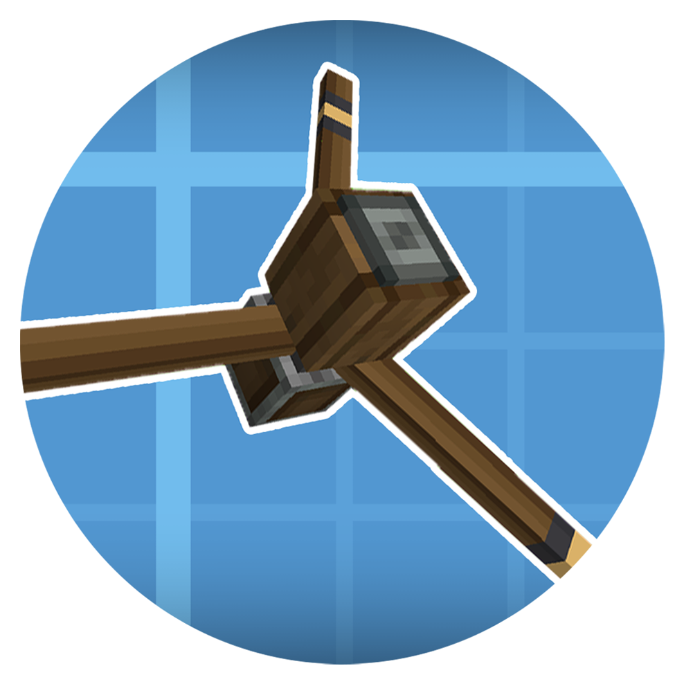

# Integrated Propellers

Add some different function propeller for create aeronautics.

An addon for **Create: Aeronautics** on NeoForge 1.21.1 that adds integrated
propeller bearings, eight separate propeller blade levels, and gyroscopic
wireless steering.

## Source

The complete source code, assets, Ponder data, recipes and build scripts live on
specific tree_branch.

## Requirements

- Minecraft 1.21.1
- NeoForge 21.1.233
- Create 6.0.10
- Create: Aeronautics 1.3.2
- Sable 2.0.6

## License

MIT. See the `LICENSE` file on the source branch.
